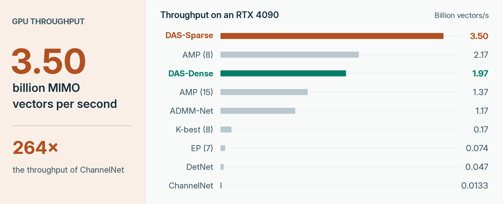

<h1>
<picture>
  <source media="(max-width: 600px)" srcset="assets/das-mimo-mobile.png">
  
</picture>
</h1>

DAS-MIMO learns the structure of a MIMO detection algorithm directly from data. Gradient descent selects the algebraic operations in each update, the variables they take as inputs, and the estimates reused from earlier iterations. The learned graph gives explicit detector equations that can be compiled into fused CUDA kernels.

[Run the pretrained detectors](#quick-start) &nbsp; | &nbsp; [Paper results](#paper-results) &nbsp; | &nbsp; [Reproduction Guide](docs/reproduction.md)

## What did the search learn?

The banner illustrates how an update can combine the current estimate with estimates from two earlier iterations. The graph below shows the complete DAS-Sparse detector learned at code rate **0.446**. Of its 36 retained operators, 32 perform clipping, scalar denoising or diagonal scaling. Only four perform full matrix–vector products. Matching capital letters show where later iterations reuse each of the 20 stored vectors.

[](assets/sparse-algorithm.png)

<details open>
<summary><strong>The DAS-MIMO framework</strong></summary>

A typed graph defines the candidate operations and their compatible inputs. A shared backbone and learned basis components adapt the graph to the code configuration. After training, the compiler prunes inactive operations, removes unused computations, and fuses the remaining expressions into CUDA kernels.

[](assets/framework.png)

</details>

## Paper results

At **$R \approx 0.675$** and **$E_b/N_0 = 9.6$ dB**, DAS-Dense achieves the lowest block error rate (BLER) among the nine detectors. Compared with ChannelNet (*IEEE Transactions on Signal Processing*, 2025), it reduces BLER from 0.01038 to **0.00308** and equivalent FLOPs per vector from 498.1k to **18.5k**. DAS-Sparse uses the fewest FLOPs (**9.3k**) and also achieves a lower BLER than ChannelNet (**0.00646**). [ChannelNet paper](https://doi.org/10.1109/TSP.2025.3594197)

<picture>
  <source media="(max-width: 600px)" srcset="assets/cost-and-bler-mobile.png">
  
</picture>

The comparison uses 16 receive and eight transmit antennas, 16-QAM, 1,024-bit LDPC codewords and perfect channel knowledge. Each channel matrix is reused for 64 receive vectors.

On an RTX 4090, DAS-Sparse processes **3.50 billion MIMO vectors/s**, compared with **13.3 million** for ChannelNet, a **264×** throughput advantage. The measurement includes preprocessing for 128 channel matrices, each reused for 512 receive vectors.

<picture>
  <source media="(max-width: 600px)" srcset="assets/throughput-mobile.png">
  
</picture>

## Quick Start

> **[Reproduction Guide →](docs/reproduction.md)**
>
> Follow the guide to [generate data and train detectors](docs/reproduction.md#train-a-detector), [evaluate BLER](docs/reproduction.md#evaluate-bler), [export CUDA and count FLOPs](docs/reproduction.md#export-cuda-and-count-flops), or [benchmark GPU throughput](docs/reproduction.md#measure-gpu-throughput).

To evaluate the included pretrained weights, run the following commands in a Python 3.10 environment.

```bash
git clone https://github.com/NaLv2004/DAS-MIMO.git
cd DAS-MIMO
python -m pip install -r requirements.txt
python evaluate.py --models das_sparse das_dense --rate 0.8 --snr 10.1 --frames 1024
```

| Detector | Training code rates | Configuration | Checkpoint |
|---|---|---|---|
| **DAS-Sparse** | 0.3–0.8 | [Sparse](configs/das_sparse.json) | [Weights](checkpoints/das_sparse.pt) |
| **DAS-Dense** | 0.6–0.8 | [Dense](configs/das_dense.json) | [Weights](checkpoints/das_dense.pt) |

## Baselines

The repository includes trained [ADMM-Net](checkpoints/admm_net.pt), [DetNet](checkpoints/detnet.pt) and [ChannelNet](checkpoints/channelnet.pt) models, together with [MMSE, AMP, EP and K-best](dasmimo/baselines/classical.py).

<details open>
<summary><strong>Baseline papers and public implementations</strong></summary>

| Detector | Paper | Public implementation |
|---|---|---|
| ADMM-Net | Kim and Park, [Learnable MIMO Detection Networks Based on Inexact ADMM](https://ieeexplore.ieee.org/document/9210880), IEEE TWC, 2021 | [Authors’ repository](https://github.com/Minsik-K/ADMM-Net-for-MIMO-Detection) |
| DetNet | Samuel, Diskin, and Wiesel, [Learning to Detect](https://doi.org/10.1109/TSP.2019.2899805), IEEE TSP, 2019 | [Authors’ 16-QAM implementation](https://github.com/neevsamuel/LearningToDetect/blob/master/DetNet_HD_16QAM.py) |
| ChannelNet | Ye and Liang, [On Purely Data-Driven Massive MIMO Detectors](https://doi.org/10.1109/TSP.2025.3594197), IEEE TSP, 2025 | [Authors’ repository](https://github.com/UCSC-Edge-AI-Lab/ChannelNet) |
| Linear MMSE | McKay, Collings, and Tulino, [Achievable Sum Rate of MIMO MMSE Receivers: A General Analytic Framework](https://doi.org/10.1109/TIT.2009.2034893), IEEE TIT, 2010 | [IIP Group, unbiased MMSE](https://github.com/IIP-Group/massiveMIMOdetection/blob/main/detectors/MMSE.m) |
| AMP (LAMA) | Jeon, Ghods, Maleki, and Studer, [Optimality of Large MIMO Detection via Approximate Message Passing](https://doi.org/10.1109/ISIT.2015.7282651), IEEE ISIT, 2015 | [IIP Group, LAMA](https://github.com/IIP-Group/massiveMIMOdetection/blob/main/detectors/LAMA.m) |
| EP | Céspedes, Olmos, Sánchez-Fernández, and Pérez-Cruz, [Expectation Propagation Detection for High-Order High-Dimensional MIMO Systems](https://doi.org/10.1109/TCOMM.2014.2332349), IEEE TCOM, 2014 | [NVIDIA Sionna, EPDetector](https://github.com/NVlabs/sionna/blob/2f0a3820269b53fd022780a6f2f5f720f7ceb9b4/src/sionna/phy/mimo/detection.py#L1080) |
| K-best | Guo and Nilsson, [Algorithm and Implementation of the K-Best Sphere Decoding for MIMO Detection](https://doi.org/10.1109/JSAC.2005.862402), IEEE JSAC, 2006 | [IIP Group, K-best search](https://github.com/IIP-Group/massiveMIMOdetection/blob/main/detectors/KBEST.m) |

</details>
