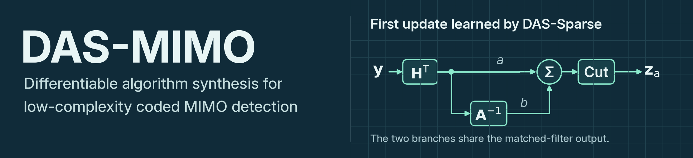
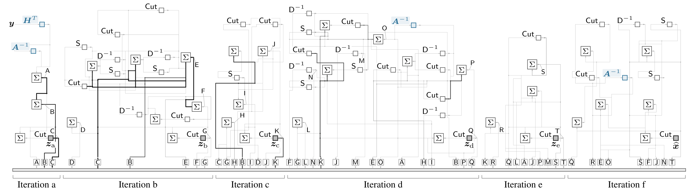
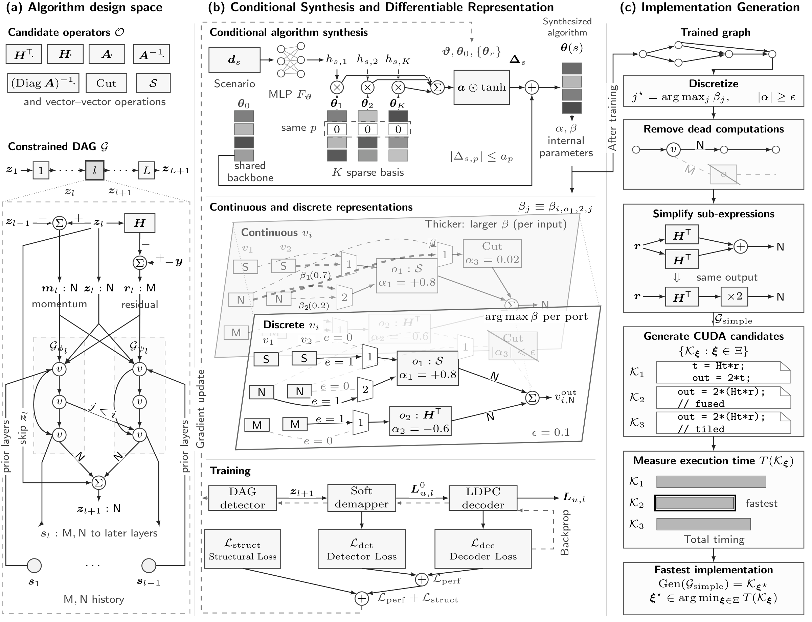
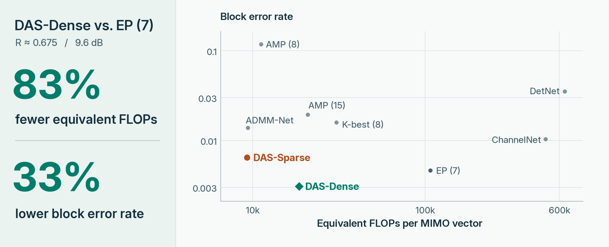

<h1>
<picture>
  <source media="(max-width: 600px)" srcset="assets/das-mimo-mobile.png">
  
</picture>
</h1>

**Jiayan Xu, Huayi Zhou, and Chuan Zhang**

DAS-MIMO learns the structure of a MIMO detection algorithm directly from data. Gradient descent selects the algebraic operations in each update, the variables they take as inputs, and the estimates reused from earlier iterations. The learned graph gives explicit detector equations that can be compiled into fused CUDA kernels.

[Run the pretrained detectors](#quick-start) &nbsp; | &nbsp; [Paper results](#paper-results) &nbsp; | &nbsp; [Training and benchmarks](docs/reproduction.md)

## What did the search learn?

At code rate **0.446**, the first DAS-Sparse update computes the matched-filter output once. One branch uses this vector directly and the other multiplies it by the inverse regularized Gram matrix. The detector combines the branches with learned weights $a$ and $b$ and clips the result.

In the full graph below, 32 of the 36 retained operators perform clipping, scalar denoising or diagonal scaling. Only four perform full matrix–vector products. The capital letters trace 20 intermediate vectors reused across iterations.

[](assets/sparse-algorithm.png)

<details>
<summary><strong>View the full DAS-MIMO framework</strong></summary>

A typed graph defines the candidate operations and their compatible inputs. A shared backbone and learned basis components adapt the graph to the code configuration. After training, the compiler prunes inactive operations, removes unused computations, and fuses the remaining expressions into CUDA kernels.

[](assets/framework.png)

</details>

## Paper results

At **$R \approx 0.675$** and **$E_b/N_0 = 9.6$ dB**, DAS-Sparse uses the fewest FLOPs of the nine detectors and achieves one-third the block error rate (BLER) of AMP (15). DAS-Dense achieves the lowest BLER. Compared with EP (7), it reduces BLER from 0.00463 to 0.00308 and equivalent FLOPs per vector from 107.1k to 18.5k.

<picture>
  <source media="(max-width: 600px)" srcset="assets/cost-and-bler-mobile.png">
  
</picture>

The comparison uses 16 receive and eight transmit antennas, 16-QAM, 1,024-bit LDPC codewords and perfect channel knowledge. Each channel matrix is reused for 64 receive vectors.

DAS-Sparse achieves the highest GPU throughput among the detectors compared in the paper. The measurement below includes preprocessing on **128 channel matrices**, each reused for **512 receive vectors**.

<picture>
  <source media="(max-width: 600px)" srcset="assets/throughput-mobile.png">
  
</picture>

## Quick start

The pretrained weights are included in the repository. From a Python 3.10 environment:

```bash
git clone https://github.com/NaLv2004/DAS-MIMO.git
cd DAS-MIMO
python -m pip install -r requirements.txt
python evaluate.py --models das_sparse das_dense --rate 0.8 --snr 10.1 --frames 1024
```

| Detector | Training code rates | Configuration | Checkpoint |
|---|---|---|---|
| **DAS-Sparse** | 0.3–0.8 | [Sparse](configs/das_sparse.json) | [Weights](checkpoints/das_sparse.pt) |
| **DAS-Dense** | 0.6–0.8 | [Dense](configs/das_dense.json) | [Weights](checkpoints/das_dense.pt) |

The [reproduction guide](docs/reproduction.md) covers dataset generation, model training, BLER evaluation, CUDA export, FLOP counts and RTX 4090 throughput measurements.

## Baselines

The repository includes trained [ADMM-Net](checkpoints/admm_net.pt), [DetNet](checkpoints/detnet.pt) and [ChannelNet](checkpoints/channelnet.pt) models, together with [MMSE, AMP, EP and K-best](dasmimo/baselines/classical.py).

<details>
<summary><strong>Baseline papers and public implementations</strong></summary>

| Detector | Paper | Public implementation |
|---|---|---|
| ADMM-Net | Kim and Park, [Learnable MIMO Detection Networks Based on Inexact ADMM](https://ieeexplore.ieee.org/document/9210880), IEEE TWC, 2021 | [Authors’ repository](https://github.com/Minsik-K/ADMM-Net-for-MIMO-Detection) |
| DetNet | Samuel, Diskin, and Wiesel, [Learning to Detect](https://doi.org/10.1109/TSP.2019.2899805), IEEE TSP, 2019 | [Authors’ 16-QAM implementation](https://github.com/neevsamuel/LearningToDetect/blob/master/DetNet_HD_16QAM.py) |
| ChannelNet | Ye and Liang, [On Purely Data-Driven Massive MIMO Detectors](https://doi.org/10.1109/TSP.2025.3594197), IEEE TSP, 2025 | [Authors’ repository](https://github.com/UCSC-Edge-AI-Lab/ChannelNet) |
| Linear MMSE | McKay, Collings, and Tulino, [Achievable Sum Rate of MIMO MMSE Receivers: A General Analytic Framework](https://doi.org/10.1109/TIT.2009.2034893), IEEE TIT, 2010 | [IIP Group, unbiased MMSE](https://github.com/IIP-Group/massiveMIMOdetection/blob/main/detectors/MMSE.m) |
| AMP (LAMA) | Jeon, Ghods, Maleki, and Studer, [Optimality of Large MIMO Detection via Approximate Message Passing](https://doi.org/10.1109/ISIT.2015.7282651), IEEE ISIT, 2015 | [IIP Group, LAMA](https://github.com/IIP-Group/massiveMIMOdetection/blob/main/detectors/LAMA.m) |
| EP | Céspedes, Olmos, Sánchez-Fernández, and Pérez-Cruz, [Expectation Propagation Detection for High-Order High-Dimensional MIMO Systems](https://doi.org/10.1109/TCOMM.2014.2332349), IEEE TCOM, 2014 | [NVIDIA Sionna, EPDetector](https://github.com/NVlabs/sionna/blob/2f0a3820269b53fd022780a6f2f5f720f7ceb9b4/src/sionna/phy/mimo/detection.py#L1080) |
| K-best | Guo and Nilsson, [Algorithm and Implementation of the K-Best Sphere Decoding for MIMO Detection](https://doi.org/10.1109/JSAC.2005.862402), IEEE JSAC, 2006 | [IIP Group, K-best search](https://github.com/IIP-Group/massiveMIMOdetection/blob/main/detectors/KBEST.m) |

</details>
